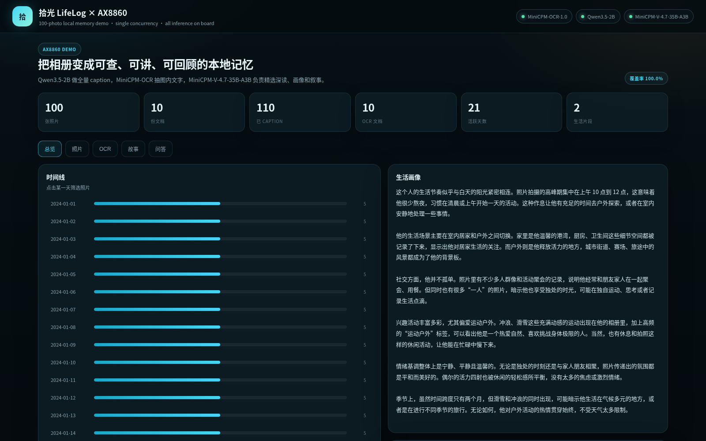
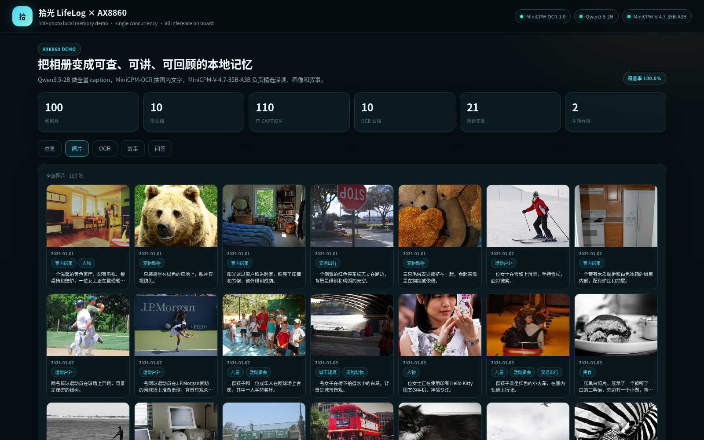
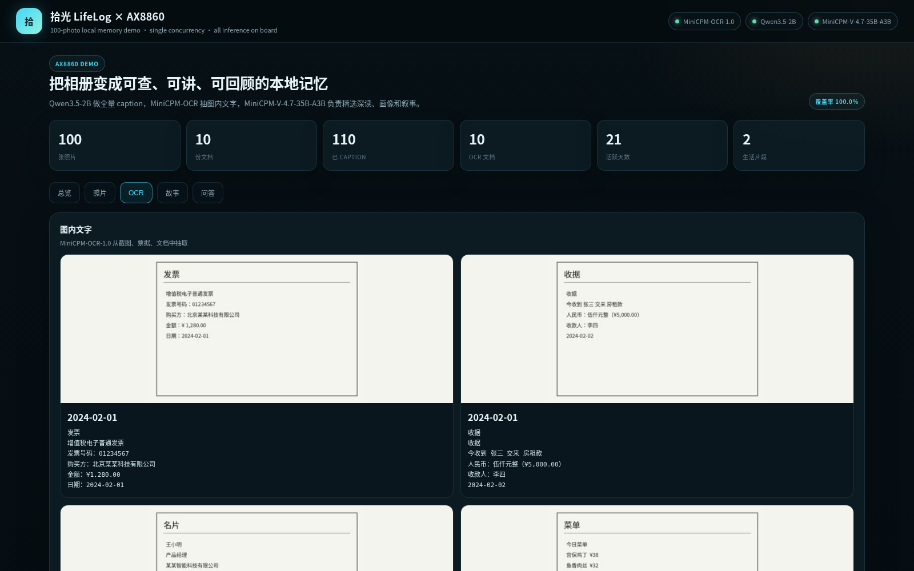
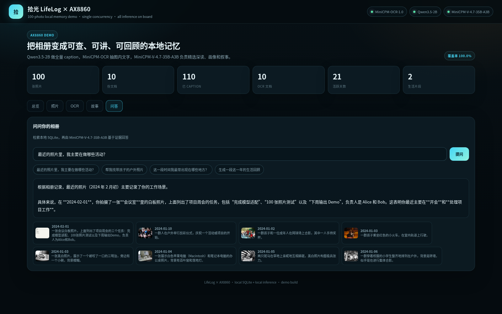
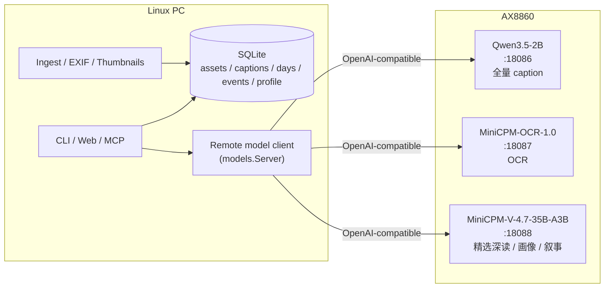

# 拾光 LifeLog × AX8860

**本地优先的个人相册记忆系统 · AX8860 推理 Demo**

把 100 张照片变成可浏览、可检索、可讲述的本地记忆：Qwen3.5-2B 负责全量
caption，MiniCPM-OCR 负责图内文字，MiniCPM-V-4.7-35B-A3B 负责精选深读、
生活画像和叙事。数据、SQLite、Web/MCP 都在 PC；板端只做推理。

> 当前为 **Demo 分支**，使用 100 张 COCO 真实照片作为占位测试集，
> 正式演示时替换成个人相册即可。



## 致谢

本项目基于并参考了 [`lengjingxu/lifelog-minicpm`](https://github.com/lengjingxu/lifelog-minicpm)
的相册入库、SQLite 数据模型、caption/OCR/聚合/画像/叙事/MCP/Web 设计。原始项目采用
MIT License，原始版权归原作者 **leng** 所有（Copyright (c) 2026 leng）。

AX8860 适配部分（远程模型层、板端模型分工、Web Demo、单并发调度、100 张照片测试）
由 BUG1989 维护，同样以 MIT License 发布。完整许可见 [`LICENSE`](LICENSE)，第三方
组件与模型归属见 [`NOTICE`](NOTICE)。

---

## 1. 项目简介

`lifelog-8860` 是 [`lengjingxu/lifelog-minicpm`](https://github.com/lengjingxu/lifelog-minicpm)
的 AX8860 适配分支。上游项目本身是一个完整的本地相册人生回顾系统；这个分支
把原本在 Apple Silicon 上本地启动 `llama-server` 的模型层，替换成 AX8860 上的
OpenAI-compatible 远程推理。

Demo 目标：

```text
100 张真实照片
  → 本地 SQLite 资产库
  → Qwen3.5-2B 全量 caption
  → MiniCPM-OCR 抽取文档文字
  → 按天/事件聚合
  → MiniCPM-V-4.7-35B-A3B 生成画像/故事
  → Web 页面浏览、检索、问答
```

核心原则：

- **照片和数据库留在 PC**，板端只接收压缩后的图片请求
- **单并发**，不依赖多 slot / `--parallel`
- **小模型全量跑，大模型精选跑**
- **事实由 SQLite 统计，模型只负责组织语言**

---

## 2. 示例图片

| 总览 | 照片 |
|---|---|
|  |  |

| OCR | 问答 |
|---|---|
|  |  |

Web Demo 入口：

```text
http://<pc-ip>:8766/ax8860
```

---

## 3. 核心能力

- 本地相册扫描、EXIF 时间、缩略图、SQLite 入库
- Qwen3.5-2B 逐张生成结构化 caption：
  `caption / scene / people / place / activity / mood / tags`
- MiniCPM-OCR 从截图、票据、菜单、车票、名片、公告等图片中抽取文字
- 按天聚合时间线、按连续日期聚合生活片段
- 35B-A3B 生成第三人称画像、第一人称回顾、给十年后的你、给家人的信
- 基于 SQLite 证据的本地问答，返回关联照片
- Web Demo：模型状态、时间线、照片网格、OCR、故事、问答
- MCP / CLI 保留上游接口

---

## 4. 架构



数据流：

```text
照片目录
  → lifelog ingest
  → assets 表 + 缩略图
  → lifelog caption --model qwen3.5-2b
  → captions 表
  → lifelog ocr --model minicpm-ocr-1.0
  → captions.ocr_text
  → lifelog aggregate
  → days / events
  → lifelog profile / story --model minicpm-v-4.7-35b-a3b
  → profile 表
  → Web / CLI / MCP / ask
```

### 远程模型层

`lifelog/models.py` 的 `Server` 同时支持两种模式：

| 模式 | 行为 |
|---|---|
| 本地 | 启动 `llama-server` 子进程，用完停止 |
| 远程（AX8860） | 不启动本地进程，只检查 `/health`，请求发到板端 |

远程模式强制 `parallel = 1`，避免误用 `--parallel`。

---

## 5. 模型分工

| 阶段 | 模型 | 端口 | 说明 |
|---|---|---:|---|
| 全量 caption | Qwen3.5-2B | 18086 | 约 2.0~2.9s/张 |
| OCR | MiniCPM-OCR-1.0 | 18087 | 文档/截图/票据 |
| 精选深读 | MiniCPM-V-4.7-35B-A3B | 18088 | 画像、故事、问答 |

推荐 35B-A3B 启动 profile：

```text
context: 16384
batch:   4096
ubatch:  4096
ctxcp:   8
cache_ram: 4096
```

> 板端为单 slot。Demo 不启用并发。

---

## 6. 100 张照片 Demo 结果

测试环境：AX8860P，SDK V0.6.0，单并发。

| 阶段 | 结果 |
|---|---:|
| 100 张照片 caption（Qwen3.5-2B） | **2m55s**，100/100 成功 |
| 平均单张 | **约 1.75s** |
| 10 份文档 OCR | **8.75s**，10/10 非空 |
| 35B 生活画像 | **18.7s** |
| 35B 三种故事 | **12.1s** |
| 35B 问答 | **2.4s** |
| 数据库 | 110 资产 / 110 caption / 10 OCR / 21 天 / 2 事件 |

板端三模型常驻资源：

```text
监听端口: 18086 / 18087 / 18088
CMM used: ~34 GB / 48 GB
OS available: ~9 GB
```

---

## 7. 安装

### 7.1 PC 环境

要求：Python 3.10+，能访问板卡网络。

```bash
cd lifelog-8860
python3 -m venv .venv
.venv/bin/pip install -e .
```

### 7.2 配置

```bash
cp config/ax8860.env.example .env.local
```

编辑 `.env.local`：

```bash
LIFELOG_REMOTE_QWEN35_2B=http://<board-ip>:18086
LIFELOG_REMOTE_MINICPM_OCR=http://<board-ip>:18087
LIFELOG_REMOTE_MINICPM_V_35B=http://<board-ip>:18088
LIFELOG_HOME=/path/to/lifelog-8860/data/lifelog-demo
```

加载配置：

```bash
set -a
source .env.local
set +a
```

### 7.3 板端模型

板端需要先启动三个服务。可以用 AXERA Model Manager，也可以直接用模型包脚本。

```text
Qwen3.5-2B                 :18086
MiniCPM-OCR-1.0            :18087
MiniCPM-V-4.7-35B-A3B      :18088
```

检查：

```bash
.venv/bin/python scripts/ax8860_status.py
```

输出示例：

```text
qwen3.5-2b                     ok=ok model=...
minicpm-ocr-1.0                ok=ok model=...
minicpm-v-4.7-35b-a3b          ok=ok model=...
ports: [18088, 18086, 18087]
```

---

## 8. 准备照片

目录约定：

```text
data/lifelog-demo/
├── photos/          # 100 张照片
├── docs/            # 10 张文档/截图/票据
└── lifelog.sqlite   # 自动生成
```

当前仓库中 `photos/` 和 `docs/` 不提交 Git，属于本地 Demo 数据。

替换成自己的相册：

```bash
rm -rf data/lifelog-demo/photos
mkdir -p data/lifelog-demo/photos
cp /path/to/your/photos/*.jpg data/lifelog-demo/photos/
```

> 如果没有 EXIF 拍摄时间，`ingest` 会退回使用文件 mtime。

---

## 9. 运行 Pipeline

一条命令：

```bash
scripts/ax8860_demo.sh
```

手动分步：

```bash
export LIFELOG_HOME="$PWD/data/lifelog-demo"

# 1. 入库
.venv/bin/python -m lifelog.cli ingest "$LIFELOG_HOME/photos"
.venv/bin/python -m lifelog.cli ingest "$LIFELOG_HOME/docs"

# 2. 全量 caption
.venv/bin/python -m lifelog.cli caption \
  --model qwen3.5-2b --concurrency 1

# 3. OCR
.venv/bin/python -m lifelog.cli ocr \
  --model minicpm-ocr-1.0 --since 2024-02-01

# 4. 聚合
.venv/bin/python -m lifelog.cli aggregate --model qwen3.5-2b

# 5. 画像
.venv/bin/python -m lifelog.cli profile \
  --model minicpm-v-4.7-35b-a3b --describe-model qwen3.5-2b

# 6. 三种故事
.venv/bin/python -m lifelog.cli story \
  --model minicpm-v-4.7-35b-a3b --all-voices

# 7. 问答
.venv/bin/python -m lifelog.cli ask \
  "最近的照片里，我主要在做哪些活动？" \
  --model minicpm-v-4.7-35b-a3b
```

---

## 10. Web Demo

```bash
export LIFELOG_HOME="$PWD/data/lifelog-demo"
.venv/bin/python -m lifelog.cli serve-web --host 0.0.0.0 --port 8766
```

打开：

```text
http://<pc-ip>:8766/ax8860
```

页面包含：

- 模型在线状态
- 100 张照片 / 10 份文档 / caption / OCR / 活跃天数 / 事件
- 可点击的时间线
- 照片网格 + caption + 标签 + 大图预览
- OCR 文档卡片
- 35B 画像 + 三种故事
- 基于 SQLite 证据的问答

### Web API

| 方法 | 路径 | 说明 |
|---|---|---|
| GET | `/ax8860` | Demo 页面 |
| GET | `/api/ax8860/summary` | 指标、模型状态、时间线、画像、故事 |
| GET | `/api/ax8860/photos` | 照片列表 |
| GET | `/api/ax8860/ocr` | OCR 结果 |
| POST | `/api/ax8860/ask` | `{"question": "..."}` → 回答 + 证据 |

原始页面仍保留：

```text
/               相册
/journey        人生经历
/profile        生活画像
/events         生活片段
/stats          统计
```

---

## 11. 目录结构

```text
lifelog-8860/
├── lifelog/
│   ├── config.py           # 模型注册表 + 远程端点
│   ├── models.py           # 本地/远程 Server
│   ├── caption.py          # Qwen3.5-2B 全量 caption
│   ├── ocr.py              # MiniCPM-OCR
│   ├── aggregate.py        # 天/事件聚合
│   ├── profile.py          # 生活画像
│   ├── story.py            # 三种叙事
│   ├── query.py            # 证据检索 + 问答
│   ├── web.py              # Web 服务 + AX8860 API
│   └── assets/ax8860.html  # Demo 前端
├── scripts/
│   ├── ax8860_demo.sh      # 一键 Demo
│   └── ax8860_status.py    # 板端模型健康检查
├── config/ax8860.env.example
├── docs/ax8860-*.png       # 示例截图
├── data/lifelog-demo/      # 本地数据，gitignore
└── README.md
```

---

## 12. 设计说明

### 12.1 远程 Provider

AX8860 模型以固定端口常驻，PC 侧的 `models.Server` 不再启动本地
`llama-server`。这样：

- PC 不需要安装/编译 llama.cpp
- 模型生命周期与 PC 进程解耦
- 请求只走 OpenAI-compatible HTTP
- 远程模式天然单并发

### 12.2 单并发

板端每个模型固定 `-np 1`。Demo 明确不做并发：

- `Server.parallel = 1`
- `weekly --concurrency` 默认 1
- 100 张照片的处理时间约 3 分钟

### 12.3 OCR

OCR 对图片分辨率敏感。`ocr.py` 使用：

- 最长边 1400
- 逐行提取提示词
- 将“可读文字 / 无文字”视为空结果

10 份合成文档测试从 6/10 提升到 10/10。

### 12.4 JSON 容错

Qwen3.5-2B 可能输出：

- markdown code fence
- 顶层数组
- 截断 JSON

`caption.parse_json_object` 会提取第一个完整对象，并保留原有的补逗号/字段兜底逻辑。

---

## 13. 已知限制

| 限制 | 说明 |
|---|---|
| 当前照片是 COCO 占位集 | 用于跑通链路，不是个人相册结论 |
| 35B 叙事可能推测 | 已要求只使用底稿，但仍需人工抽检 |
| 问答统计路由不完美 | 数量类问题可能没有走统计分支 |
| 单并发 | 100 张约 3 分钟，29k 张需要过夜批处理 |
| OCR 需要更多真实票据 | 当前 10 份是合成文档 |
| 无鉴权/隐私加固 | Demo 专用，不要暴露公网 |
| 无视频理解 | 上游只登记视频，不做内容理解 |
| 未做全上板 | 当前是 PC + AX8860 分离架构 |
| 35B-A3B 质量仍需评估 | 与 MiniCPM-V-8B 的差距需要真实相册对比 |

---

## 14. Roadmap

- [ ] 用真实 100 张个人照片替换 COCO 占位集
- [ ] 增加 1,000 张照片的吞吐/稳定性测试
- [ ] 给画像和故事增加证据引用与事实白名单
- [ ] 改进数量类问题的统计路由
- [ ] 增加真实票据/截图 OCR 评测集
- [ ] 加语音问答：Qwen3-ASR + MCP + VoxCPM2
- [ ] 录制 Web Demo 视频
- [ ] 可选：Python/SQLite/Web 全上板
- [ ] 可选：鉴权、多用户、数据加密

---

## 15. License / Attribution

本仓库继承上游 `lifelog-minicpm` 的 MIT License，详见 [`LICENSE`](LICENSE)：

```text
MIT License
Copyright (c) 2026 leng
```

AX8860 适配部分同样以 MIT License 发布。

模型权重不随仓库分发。部署时使用的模型包括：

- Qwen3.5-2B
- MiniCPM-OCR-1.0
- MiniCPM-V-4.7-35B-A3B

请分别确认各模型的上游许可、商用范围和再分发条件。

上游项目：

- <https://github.com/lengjingxu/lifelog-minicpm>

第三方组件与模型归属：

- 见 [`NOTICE`](NOTICE)
